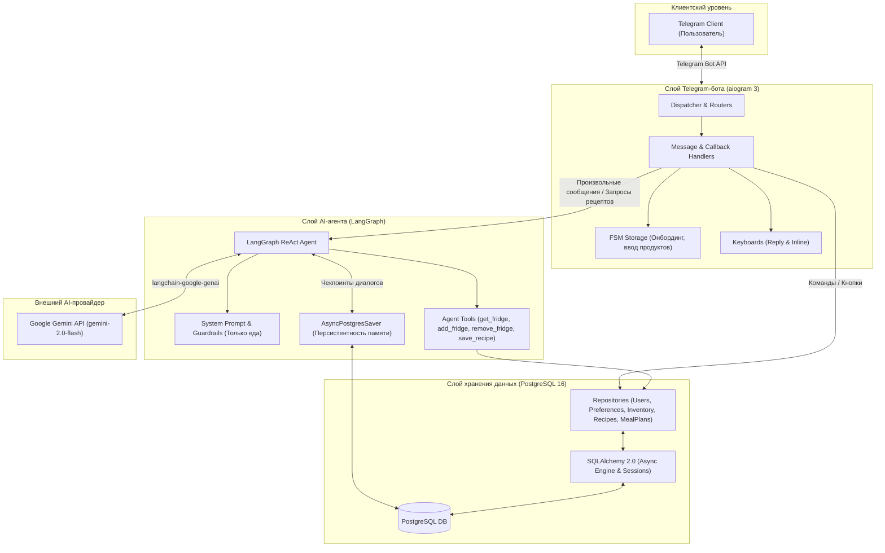

# Архитектура системы «Персональный повар»

Документ описывает архитектуру программного комплекса «Персональный повар», взаимодействие компонентов, потоки данных и структуру кодовой базы.

---

## 1. Общая архитектурная диаграмма



---

## 2. Ключевые компоненты

### 2.1. Уровень Telegram-бота (`personal_chef.handlers`, `keyboards`)
- **Маршрутизация**: разбор входящих событий (`Message`, `CallbackQuery`).
- **FSM-контроллеры**: изолированное управление состояниями онбординга (`OnboardingStates`) и добавления продуктов (`FridgeStates`).
- **Интерфейсы ввода**: Reply-клавиатуры для главного меню и Inline-кнопки для быстрых действий (выбор приема пищи, выбор из вариантов блюд, отметка «Приготовлено»).

### 2.2. Уровень AI-агента (`personal_chef.agent`)
- **Граф агента**: скомпилированный граф LangGraph с логикой ReAct (цикл планирования, вызова инструментов и формирования ответа).
- **Инструменты (Tools)**: функции с описанием Pydantic-схем аргументов, позволяющие модели читать и модифицировать инвентарь холодильника и историю блюд.
- **Guardrails**: строгая валидация контекста диалога на кулинарную тематику с мгновенным возвратом вежливого отказа при попытках оффтопа.
- **Память диалогов**: `AsyncPostgresSaver`, сохраняющий историю взаимодействия по уникальному `thread_id` каждого пользователя.

### 2.3. Уровень доступа к данным (`personal_chef.db`, `repositories`)
- **Асинхронные сессии**: `async_sessionmaker` с управлением жизненным циклом через контекстные менеджеры.
- **Паттерн Репозиторий**: изоляция SQL-запросов от бизнес-логики бота и агента.

---

## 3. Основные потоки данных (Data Flows)

### 3.1. Онбординг нового пользователя
1. Пользователь отправляет `/start`.
2. Бот проверяет наличие пользователя в таблице `users`. Если пользователя нет, создается запись и активируется состояние `OnboardingStates.allergies`.
3. Пользователь отвечает на шаги (аллергии -> диеты/вкусы -> продукты в холодильнике).
4. Записи сохраняются в `user_preferences` и `user_inventory`.
5. FSM завершается, пользователю отправляется приветственное меню.

### 3.2. Запрос на подбор блюда
1. Пользователь нажимает «🍽 Подобрать рецепт» или пишет: *«Что приготовить на обед?»*.
2. Бот запрашивает у пользователя тип приема пищи инлайн-кнопками (или парсит его из текста).
3. Агент загружает профиль (`user_preferences`) и холодильник (`user_inventory`).
4. Модель Gemini генерирует **2-3 варианта блюд** с кратким описанием.
5. Бот выводит варианты с инлайн-кнопками выбора.
6. Пользователь нажимает на выбранный вариант: агент генерирует подробный пошаговый рецепт, сохраняет его в `recipes` и `meal_plans` (со статусом `planned`).
7. Пользователь получает рецепт и кнопку «✅ Приготовлено (списать продукты)».

### 3.3. Фиксация приготовления и списание продуктов
1. Пользователь нажимает кнопку «✅ Приготовлено (списать продукты)».
2. Статус приема пищи в таблице `meal_plans` обновляется на `cooked`.
3. Бот предлагает список продуктов, использованных в рецепте, и позволяет пользователю в один клик подтвердить списание из `user_inventory`.

---

## 4. Структура кодовой базы

```text
src/personal_chef/
├── agent/                  # Логика AI-агента на LangGraph
│   ├── graph.py            # Построение и компиляция графа
│   ├── prompts.py          # Системные промпты и guardrails
│   └── tools.py            # Инструменты агента (get_fridge, update_fridge, save_recipe)
├── config.py               # Pydantic Settings (BOT_TOKEN, DATABASE_URL, GEMINI_API_KEY)
├── db/                     # Слой работы с базой данных
│   ├── base.py             # SQLAlchemy DeclarativeBase
│   ├── models/             # Модели (User, UserPreference, UserInventory, Recipe, MealPlan)
│   ├── repositories/       # Репозитории доступа к данным
│   └── session.py          # Настройка async_engine и sessionmaker
├── handlers/               # Обработчики aiogram
│   ├── base.py             # /start, /help, /reset
│   ├── fridge.py           # Меню холодильника и добавление продуктов
│   ├── onboarding.py       # FSM онбординга
│   ├── preferences.py      # Просмотр и редактирование предпочтений
│   └── recipes.py          # Подбор рецептов и отметка приготовления
├── keyboards/              # Клавиатуры (Reply & Inline)
│   ├── inline.py           # Инлайн-кнопки
│   └── reply.py            # Главное меню бота
├── middlewares/            # Мидлвари aiogram (DBSessionMiddleware)
├── fsm/                    # Состояния FSM (OnboardingStates, FridgeStates)
└── main.py                 # Точка входа, запуск polling бота
```

---

## 5. Инфраструктура и запуск

- **База данных**: PostgreSQL 16 разворачивается через `docker-compose.yml`.
- **Миграции**: управление структурой БД выполняется через `alembic upgrade head`.
- **Переменные окружения** задаются в файле `.env`:
  - `BOT_TOKEN`: токен телеграм-бота от BotFather.
  - `DATABASE_URL`: строка подключения к PostgreSQL (`postgresql+asyncpg://...`).
  - `GEMINI_API_KEY`: API ключ Google Gemini.
  - `LOG_LEVEL`: уровень логирования (`INFO`, `DEBUG`).
