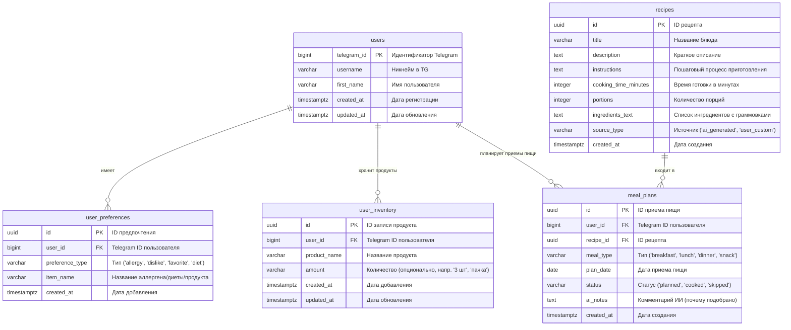
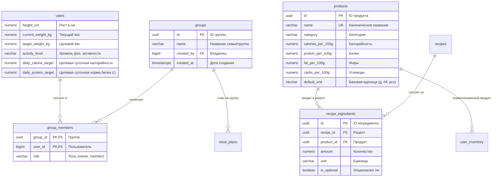

# Архитектура базы данных (PostgreSQL)

Документ описывает структуру базы данных системы «Персональный повар», разделенную на **реализуемую схему MVP** и **целевую схему v2**.

---

## 1. Схема базы данных MVP

Схема MVP спроектирована максимально чистой и сфокусированной на ключевых пользовательских сценариях: хранении профиля, предпочтений, продуктов в холодильнике, рецептов и приемов пищи.

### 1.1. Концептуальная диаграмма связей MVP (ERD)

---

### 1.2. Спецификация таблиц MVP

#### Таблица `users`
Хранит базовые профили пользователей Telegram.
- `telegram_id` (`BIGINT`, PRIMARY KEY): Уникальный Telegram ID.
- `username` (`VARCHAR(64)`, NULL): Никнейм в Telegram.
- `first_name` (`VARCHAR(128)`, NOT NULL): Имя пользователя.
- `created_at` (`TIMESTAMPTZ`, DEFAULT `CURRENT_TIMESTAMP`).
- `updated_at` (`TIMESTAMPTZ`, DEFAULT `CURRENT_TIMESTAMP`).

#### Таблица `user_preferences`
Кулинарные предпочтения, ограничения и диеты.
- `id` (`UUID`, PRIMARY KEY, DEFAULT `gen_random_uuid()`).
- `user_id` (`BIGINT`, NOT NULL, REFERENCES `users(telegram_id)` ON DELETE CASCADE).
- `preference_type` (`VARCHAR(32)`, NOT NULL):
  - `'allergy'` — аллергия / непереносимость (жесткое исключение);
  - `'dislike'` — нелюбимый продукт (мягкое исключение);
  - `'favorite'` — любимый продукт / кухня;
  - `'diet'` — тип диеты (`'vegetarian'`, `'vegan'`, `'keto'`, `'halal'` и др.).
- `item_name` (`VARCHAR(150)`, NOT NULL): Текстовое название.
- `created_at` (`TIMESTAMPTZ`, DEFAULT `CURRENT_TIMESTAMP`).
- **Индекс:** `idx_user_preferences_user_id` по `user_id`.

#### Таблица `user_inventory`
Текущий список продуктов в холодильнике пользователя.
- `id` (`UUID`, PRIMARY KEY, DEFAULT `gen_random_uuid()`).
- `user_id` (`BIGINT`, NOT NULL, REFERENCES `users(telegram_id)` ON DELETE CASCADE).
- `product_name` (`VARCHAR(150)`, NOT NULL): Название продукта (например, «куриное филе», «яйца»).
- `amount` (`VARCHAR(64)`, NULL): Опциональное количество («3 шт», «500 г», «пачка»).
- `created_at` (`TIMESTAMPTZ`, DEFAULT `CURRENT_TIMESTAMP`).
- `updated_at` (`TIMESTAMPTZ`, DEFAULT `CURRENT_TIMESTAMP`).
- **Индекс:** `idx_user_inventory_user_id` по `user_id`.

#### Таблица `recipes`
Сгенерированные и сохраненные рецепты блюд.
- `id` (`UUID`, PRIMARY KEY, DEFAULT `gen_random_uuid()`).
- `title` (`VARCHAR(255)`, NOT NULL): Название блюда.
- `description` (`TEXT`, NULL): Краткое описание.
- `instructions` (`TEXT`, NOT NULL): Пошаговые инструкции приготовления.
- `cooking_time_minutes` (`INTEGER`, NULL): Время приготовления в минутах.
- `portions` (`INTEGER`, DEFAULT 1): Количество порций.
- `ingredients_text` (`TEXT`, NOT NULL): Форматированный список ингредиентов.
- `source_type` (`VARCHAR(32)`, DEFAULT `'ai_generated'`).
- `created_at` (`TIMESTAMPTZ`, DEFAULT `CURRENT_TIMESTAMP`).

#### Таблица `meal_plans`
История и план приемов пищи.
- `id` (`UUID`, PRIMARY KEY, DEFAULT `gen_random_uuid()`).
- `user_id` (`BIGINT`, NOT NULL, REFERENCES `users(telegram_id)` ON DELETE CASCADE).
- `recipe_id` (`UUID`, NOT NULL, REFERENCES `recipes(id)` ON DELETE CASCADE).
- `meal_type` (`VARCHAR(32)`, NOT NULL): `'breakfast'`, `'lunch'`, `'dinner'`, `'snack'`.
- `plan_date` (`DATE`, NOT NULL, DEFAULT `CURRENT_DATE`).
- `status` (`VARCHAR(32)`, DEFAULT `'planned'`): `'planned'`, `'cooked'`, `'skipped'`.
- `ai_notes` (`TEXT`, NULL): Обоснование выбора блюда.
- `created_at` (`TIMESTAMPTZ`, DEFAULT `CURRENT_TIMESTAMP`).

---

### 1.3. Таблицы персистентности LangGraph (`PostgresSaver`)
Управляются стандартной библиотекой `langgraph-checkpoint-postgres` (создаются автоматически через `checkpointer.setup()`):
- **`checkpoints`**: снимки состояния узлов графа (`thread_id`, `checkpoint_ns`, `checkpoint_id`, `parent_checkpoint_id`, `checkpoint`, `metadata`).
- **`checkpoint_blobs`**: тяжелые сериализованные бинарные пейлоады каналов.
- **`checkpoint_writes`**: промежуточные отложенные записи узлов графа.

---

## 2. Целевая схема базы данных (v2 / Roadmap расширения)

В версии v2 функциональность расширяется за счет биометрических расчетов, совместного семейного доступа и глубокого учета БЖУ продуктов.

### 2.1. Дополнительные сущности v2

### 2.2. Расширения PostgreSQL для v2:
- **`pg_trgm`**: нечеткий поиск продуктов по каталогу при опечатках пользователя (`CREATE EXTENSION pg_trgm;`).
- **`pgvector`**: семантический векторный поиск рецептов по сходству вкусовых профилей (`CREATE INDEX ON recipes USING hnsw (embedding vector_cosine_ops);`).
