# Архитектура базы данных (PostgreSQL)

## 1. Концептуальная диаграмма связей (ERD)

```mermaid
erDiagram
    users ||--o{ group_members : "состоит в"
    groups ||--o{ group_members : "включает"
    groups ||--o{ meal_plans : "план на группу"
    
    users ||--o{ user_inventory : "хранит в холодильнике"
    products ||--o{ user_inventory : "содержит"
    
    users ||--o{ user_preferences : "имеет предпочтения/аллергии"
    products ||--o{ user_preferences : "ссылается на (опционально)"
    
    recipes ||--o{ recipe_ingredients : "включает ингредиенты"
    products ||--o{ recipe_ingredients : "использует"
    
    users ||--o{ meal_plans : "планирует для себя"
    meal_plans ||--o{ meal_plan_items : "состоит из блюд"
    recipes ||--o{ meal_plan_items : "включает рецепт"

    users ||--o{ agent_sessions : "ведет диалог с агентом"
    agent_sessions ||--o{ checkpoints : "сохраняет историю графа"

    users {
        bigint telegram_id PK "Идентификатор Telegram"
        varchar username "Никнейм в TG"
        varchar first_name "Имя пользователя"
        varchar gender "Пол ('male', 'female')"
        date birth_date "Дата рождения (для расчета BMR)"
        numeric height_cm "Рост в см"
        numeric current_weight_kg "Текущий вес"
        numeric target_weight_kg "Целевой вес"
        varchar activity_level "Уровень физ. активности"
        numeric daily_calorie_target "Целевая суточная калорийность"
        numeric daily_protein_target "Целевая суточная норма белка (г)"
        timestamptz created_at "Дата регистрации"
        timestamptz updated_at "Дата обновления"
    }

    groups {
        uuid id PK "Уникальный ID группы"
        varchar name "Название группы (Семья, Компания)"
        bigint created_by FK "Создатель группы (users.telegram_id)"
        timestamptz created_at "Дата создания"
    }

    group_members {
        uuid group_id PK, FK "Группа"
        bigint user_id PK, FK "Участник (users.telegram_id)"
        varchar role "Роль ('owner', 'member')"
        timestamptz joined_at "Дата вступления"
    }

    products {
        uuid id PK "Уникальный ID продукта"
        varchar name UK "Название (нормализованное)"
        varchar category "Категория (птица, овощи, крупы и т.д.)"
        numeric calories_per_100g "Калорийность на 100г/мл"
        numeric protein_per_100g "Белки на 100г/мл"
        numeric fat_per_100g "Жиры на 100г/мл"
        numeric carbs_per_100g "Углеводы на 100г/мл"
        varchar default_unit "Базовая единица ('g', 'ml', 'pcs')"
        boolean is_verified "Проверен модератором / доверенный"
        timestamptz created_at "Дата создания"
    }

    user_inventory {
        uuid id PK "Запись продукта в холодильнике"
        bigint user_id FK "Владелец (users.telegram_id)"
        uuid product_id FK "Ссылка на продукт"
        numeric amount "Количество"
        varchar unit "Единица измерения"
        date expiration_date "Срок годности (опционально)"
        timestamptz added_at "Дата добавления"
        timestamptz updated_at "Дата обновления"
    }

    user_preferences {
        uuid id PK "ID предпочтения"
        bigint user_id FK "Пользователь (users.telegram_id)"
        varchar preference_type "Тип: 'allergy', 'dislike', 'favorite', 'diet'"
        varchar item_name "Текстовое описание / название"
        uuid product_id FK "Ссылка на продукт (если применимо)"
        text notes "Дополнительные примечания"
        timestamptz created_at "Дата создания"
    }

    recipes {
        uuid id PK "ID рецепта"
        varchar title "Название рецепта"
        text description "Краткое описание"
        text instructions "Пошаговый процесс приготовления"
        integer cooking_time_minutes "Время приготовления в минутах"
        integer portions "Количество порций"
        numeric total_calories "Общая калорийность блюда"
        numeric total_protein "Общий белок (г)"
        numeric total_fat "Общие жиры (г)"
        numeric total_carbs "Общие углеводы (г)"
        varchar source_type "Источник ('curated', 'ai_generated', 'user_custom')"
        bigint created_by FK "Автор (NULL, если системный)"
        timestamptz created_at "Дата создания"
        timestamptz updated_at "Дата обновления"
    }

    recipe_ingredients {
        uuid id PK "ID строки ингредиента"
        uuid recipe_id FK "ID рецепта"
        uuid product_id FK "ID продукта из каталога"
        numeric amount "Количество"
        varchar unit "Единица измерения ('g', 'ml', 'pcs')"
        boolean is_optional "Опциональный ингредиент"
    }

    meal_plans {
        uuid id PK "ID плана приема пищи"
        bigint user_id FK "Пользователь (NULL, если на группу)"
        uuid group_id FK "Группа (NULL, если персональный)"
        date plan_date "Дата приема пищи"
        varchar meal_type "Тип ('breakfast', 'lunch', 'dinner', 'snack')"
        varchar status "Статус ('planned', 'cooked', 'skipped')"
        text ai_notes "Комментарий ИИ (почему подобрано)"
        timestamptz created_at "Дата создания"
    }

    meal_plan_items {
        uuid id PK "ID блюда в приеме пищи"
        uuid meal_plan_id FK "Ссылка на план"
        uuid recipe_id FK "Ссылка на рецепт"
        integer servings "Количество порций"
        text custom_notes "Заметки / корректировки"
    }

    agent_sessions {
        varchar thread_id PK "Идентификатор сессии диалога"
        bigint user_id FK "Пользователь (users.telegram_id)"
        varchar current_flow "Текущий сценарий графа"
        boolean is_active "Активна ли сессия"
        jsonb metadata "Контекст диалога / настройки"
        timestamptz created_at "Начало сессии"
        timestamptz updated_at "Последнее взаимодействие"
    }

    checkpoints {
        text thread_id PK "Идентификатор потока LangGraph"
        text checkpoint_ns PK "Пространство имен графа"
        text checkpoint_id PK "Уникальный ID шага графа"
        text parent_checkpoint_id "Предыдущий шаг графа"
        text type "Тип сериализации"
        jsonb checkpoint "Полный снимок состояния графа"
        jsonb metadata "Метаданные шага (модель, токены)"
    }
```

---

## 2. Детальная спецификация таблиц

### 2.1. Домен: Пользователи и группы

#### Таблица `users`
Основная таблица профилей пользователей бота.
* `telegram_id` (`BIGINT`, PRIMARY KEY): Уникальный Telegram ID пользователя.
* `username` (`VARCHAR(64)`, NULL): Юзернейм в Telegram (для аналитики/поддержки).
* `first_name` (`VARCHAR(128)`, NOT NULL): Имя пользователя.
* `gender` (`VARCHAR(10)`, NULL): Пол (`'male'`, `'female'`), необходим для формул расчета калорий и метаболизма (BMR).
* `birth_date` (`DATE`, NULL): Дата рождения для расчета точного возраста.
* `height_cm` (`NUMERIC(5,2)`, NULL, `CHECK (height_cm > 0)`): Рост в сантиметрах.
* `current_weight_kg` (`NUMERIC(5,2)`, NULL, `CHECK (current_weight_kg > 0)`): Текущий вес.
* `target_weight_kg` (`NUMERIC(5,2)`, NULL): Целевой вес (похудение, удержание, набор массы).
* `activity_level` (`VARCHAR(20)`, NULL): Коэффициент физ. активности (`'sedentary'`, `'light'`, `'moderate'`, `'high'`, `'very_high'`).
* `daily_calorie_target` (`NUMERIC(6,2)`, NULL): Рассчитанная целевая калорийность рациона.
* `daily_protein_target` (`NUMERIC(6,2)`, NULL): Целевая суточная норма белка в граммах (ключевая фича из ТЗ).
* `created_at` (`TIMESTAMPTZ`, DEFAULT `CURRENT_TIMESTAMP`).
* `updated_at` (`TIMESTAMPTZ`, DEFAULT `CURRENT_TIMESTAMP`).

#### Таблица `groups`
Сущность группы пользователей (семья, совместное приготовление ужина).
* `id` (`UUID`, PRIMARY KEY, DEFAULT `gen_random_uuid()`): Уникальный идентификатор.
* `name` (`VARCHAR(128)`, NOT NULL): Название группы (например, «Семья Ивановых»).
* `created_by` (`BIGINT`, NOT NULL, REFERENCES `users(telegram_id)` ON DELETE CASCADE): Создатель/владелец.
* `created_at` (`TIMESTAMPTZ`, DEFAULT `CURRENT_TIMESTAMP`).

#### Таблица `group_members`
Связующая таблица «Многие-ко-многим» (M:N) между пользователями и группами.
* `group_id` (`UUID`, NOT NULL, REFERENCES `groups(id)` ON DELETE CASCADE).
* `user_id` (`BIGINT`, NOT NULL, REFERENCES `users(telegram_id)` ON DELETE CASCADE).
* `role` (`VARCHAR(32)`, DEFAULT `'member'`): Роль (`'owner'`, `'member'`).
* `joined_at` (`TIMESTAMPTZ`, DEFAULT `CURRENT_TIMESTAMP`).
* **Ограничение:** PRIMARY KEY (`group_id`, `user_id`).

---

### 2.2. Домен: Продукты и Холодильник (Инвентарь)

#### Таблица `products`
Глобальный нормализованный справочник продуктов с БЖУ и калорийностью.
* `id` (`UUID`, PRIMARY KEY, DEFAULT `gen_random_uuid()`).
* `name` (`VARCHAR(150)`, NOT NULL, UNIQUE): Каноническое название продукта в нижнем регистре (например, «грудка куриная филе»).
* `category` (`VARCHAR(64)`, NULL): Категория («Мясо и птица», «Овощи», «Молочные продукты», «Крупы» и т.д.).
* `calories_per_100g` (`NUMERIC(6,2)`, NOT NULL, `CHECK (calories_per_100g >= 0)`): Калорийность на 100 г (или 100 мл).
* `protein_per_100g` (`NUMERIC(6,2)`, NOT NULL, `CHECK (protein_per_100g >= 0)`): Белки на 100 г.
* `fat_per_100g` (`NUMERIC(6,2)`, NOT NULL, `CHECK (fat_per_100g >= 0)`): Жиры на 100 г.
* `carbs_per_100g` (`NUMERIC(6,2)`, NOT NULL, `CHECK (carbs_per_100g >= 0)`): Углеводы на 100 г.
* `default_unit` (`VARCHAR(10)`, DEFAULT `'g'`): Базовая единица (`'g'`, `'ml'`, `'pcs'`).
* `is_verified` (`BOOLEAN`, DEFAULT TRUE): Флаг проверенного справочного продукта.
* `created_at` (`TIMESTAMPTZ`, DEFAULT `CURRENT_TIMESTAMP`).

#### Таблица `user_inventory`
Холодильник / текущие запасы конкретного пользователя.
* `id` (`UUID`, PRIMARY KEY, DEFAULT `gen_random_uuid()`).
* `user_id` (`BIGINT`, NOT NULL, REFERENCES `users(telegram_id)` ON DELETE CASCADE).
* `product_id` (`UUID`, NOT NULL, REFERENCES `products(id)` ON DELETE RESTRICT).
* `amount` (`NUMERIC(8,2)`, NOT NULL, `CHECK (amount > 0)`): Фактическое количество.
* `unit` (`VARCHAR(10)`, NOT NULL): Единица измерения (`'g'`, `'kg'`, `'ml'`, `'l'`, `'pcs'`).
* `expiration_date` (`DATE`, NULL): Срок годности продукта для приоритизации в меню.
* `added_at` (`TIMESTAMPTZ`, DEFAULT `CURRENT_TIMESTAMP`).
* `updated_at` (`TIMESTAMPTZ`, DEFAULT `CURRENT_TIMESTAMP`).
* **Индекс:** UNIQUE (`user_id`, `product_id`).

---

### 2.3. Домен: Предпочтения, диеты и исключения

#### Таблица `user_preferences`
Единая таблица ограничений, вкусов и диет.
* `id` (`UUID`, PRIMARY KEY, DEFAULT `gen_random_uuid()`).
* `user_id` (`BIGINT`, NOT NULL, REFERENCES `users(telegram_id)` ON DELETE CASCADE).
* `preference_type` (`VARCHAR(32)`, NOT NULL):
  * `'allergy'` — аллергия / непереносимость (жесткое исключение).
  * `'dislike'` — нелюбимый продукт (мягкое исключение).
  * `'favorite'` — любимый продукт / предпочтение.
  * `'diet'` — диетический профиль (`'vegan'`, `'vegetarian'`, `'halal'`, `'keto'`).
* `item_name` (`VARCHAR(150)`, NOT NULL): Название (например, «арахис», «кинза», «лактоза»).
* `product_id` (`UUID`, NULL, REFERENCES `products(id)` ON DELETE SET NULL): Ссылка на конкретный продукт из справочника (если сопоставлен).
* `notes` (`TEXT`, NULL): Дополнительные уточнения.
* `created_at` (`TIMESTAMPTZ`, DEFAULT `CURRENT_TIMESTAMP`).

---

### 2.4. Домен: Рецепты и Ингредиенты

#### Таблица `recipes`
Рецепты блюд (каталог + созданные ИИ-агентом).
* `id` (`UUID`, PRIMARY KEY, DEFAULT `gen_random_uuid()`).
* `title` (`VARCHAR(255)`, NOT NULL): Название блюда.
* `description` (`TEXT`, NULL): Описание вкуса, особенностей блюда.
* `instructions` (`TEXT`, NOT NULL): Пошаговые шаги приготовления.
* `cooking_time_minutes` (`INTEGER`, NULL, `CHECK (cooking_time_minutes > 0)`): Время приготовления.
* `portions` (`INTEGER`, DEFAULT 1, `CHECK (portions > 0)`): Количество порций по умолчанию.
* `total_calories` (`NUMERIC(7,2)`, NOT NULL, DEFAULT 0): Суммарные калории на порцию.
* `total_protein` (`NUMERIC(6,2)`, NOT NULL, DEFAULT 0): Суммарный белок (г) на порцию.
* `total_fat` (`NUMERIC(6,2)`, NOT NULL, DEFAULT 0): Суммарные жиры (г) на порцию.
* `total_carbs` (`NUMERIC(6,2)`, NOT NULL, DEFAULT 0): Суммарные углеводы (г) на порцию.
* `source_type` (`VARCHAR(32)`, DEFAULT `'curated'`): `'curated'` (базовый рецепт), `'ai_generated'` (сгенерирован ИИ под холодильник), `'user_custom'` (добавлен вручную).
* `created_by` (`BIGINT`, NULL, REFERENCES `users(telegram_id)` ON DELETE SET NULL): Автор пользовательского рецепта.
* `created_at` (`TIMESTAMPTZ`, DEFAULT `CURRENT_TIMESTAMP`).
* `updated_at` (`TIMESTAMPTZ`, DEFAULT `CURRENT_TIMESTAMP`).

#### Таблица `recipe_ingredients`
Состав рецепта (связь многие-ко-многим между рецептами и продуктами с граммовками).
* `id` (`UUID`, PRIMARY KEY, DEFAULT `gen_random_uuid()`).
* `recipe_id` (`UUID`, NOT NULL, REFERENCES `recipes(id)` ON DELETE CASCADE).
* `product_id` (`UUID`, NOT NULL, REFERENCES `products(id)` ON DELETE RESTRICT).
* `amount` (`NUMERIC(8,2)`, NOT NULL, `CHECK (amount > 0)`): Требуемое количество.
* `unit` (`VARCHAR(10)`, NOT NULL): Единица измерения (`'g'`, `'ml'`, `'pcs'`).
* `is_optional` (`BOOLEAN`, DEFAULT FALSE): Опциональный ли ингредиент (например, специи, зелень).
* **Индекс:** UNIQUE (`recipe_id`, `product_id`).

---

### 2.5. Домен: Меню и Приемы пищи

#### Таблица `meal_plans`
Сформированные планы приемов пищи на день для конкретного пользователя или группы.
* `id` (`UUID`, PRIMARY KEY, DEFAULT `gen_random_uuid()`).
* `user_id` (`BIGINT`, NULL, REFERENCES `users(telegram_id)` ON DELETE CASCADE): Если меню персональное.
* `group_id` (`UUID`, NULL, REFERENCES `groups(id)` ON DELETE CASCADE): Если меню на группу (семью).
* `plan_date` (`DATE`, NOT NULL): Дата приема пищи.
* `meal_type` (`VARCHAR(32)`, NOT NULL): `'breakfast'`, `'lunch'`, `'dinner'`, `'snack'`.
* `status` (`VARCHAR(32)`, DEFAULT `'planned'`): `'planned'`, `'cooked'`, `'skipped'`.
* `ai_notes` (`TEXT`, NULL): Пояснение ИИ, почему было предложено это блюдо (например: *«Подобрано с высоким содержанием белка (42г) из курицы и яиц из вашего холодильника»*).
* `created_at` (`TIMESTAMPTZ`, DEFAULT `CURRENT_TIMESTAMP`).
* **Ограничение:** `CHECK (user_id IS NOT NULL OR group_id IS NOT NULL)`.

#### Таблица `meal_plan_items`
Конкретные блюда/рецепты, включенные в прием пищи.
* `id` (`UUID`, PRIMARY KEY, DEFAULT `gen_random_uuid()`).
* `meal_plan_id` (`UUID`, NOT NULL, REFERENCES `meal_plans(id)` ON DELETE CASCADE).
* `recipe_id` (`UUID`, NOT NULL, REFERENCES `recipes(id)` ON DELETE RESTRICT).
* `servings` (`INTEGER`, DEFAULT 1, `CHECK (servings > 0)`): Количество порций.
* `custom_notes` (`TEXT`, NULL): Дополнительные правки к рецепту.

---

### 2.6. Домен: Состояние графа агента (LangGraph / LangChain)

Для персистентности многошаговых диалогов персонального повара (сбор предпочтений, уточнение наличия продуктов, пошаговые вопросы) архитектура объединяет два уровня:
1. **Прикладной уровень сессий (`agent_sessions`)**: связь Telegram-пользователя с потоком диалога (`thread_id`), текущим сценарием и контекстом.
2. **Движок чекпоинтов LangGraph (`checkpoints`)**: официальный протокол персистентности `langgraph-checkpoint-postgres` (`AsyncPostgresSaver`).

#### Таблица `agent_sessions`
Высокоуровневая сессия взаимодействия пользователя с агентом в Telegram.
* `thread_id` (`VARCHAR(64)`, PRIMARY KEY): Уникальный ID потока диалога (например, `tg_123456789_v1`).
* `user_id` (`BIGINT`, NOT NULL, REFERENCES `users(telegram_id)` ON DELETE CASCADE): Владелец сессии.
* `current_flow` (`VARCHAR(64)`, DEFAULT `'idle'`): Активный подграф/режим (`'onboarding'`, `'fridge_audit'`, `'recipe_suggestion'`, `'menu_planning'`, `'idle'`).
* `is_active` (`BOOLEAN`, DEFAULT TRUE): Флаг активного диалога.
* `metadata` (`JSONB`, DEFAULT `'{}'::jsonb`): Прикладные настройки сессии (выбранные фильтры, временные буферы ответов).
* `created_at` (`TIMESTAMPTZ`, DEFAULT `CURRENT_TIMESTAMP`).
* `updated_at` (`TIMESTAMPTZ`, DEFAULT `CURRENT_TIMESTAMP`).

#### Таблицы состояния графа LangGraph (`PostgresSaver`)
Эти таблицы реализуют стандартный интерфейс персистентности LangGraph для хранения чекпоинтов, промежуточных состояний каналов и отложенных записей:

1. **`checkpoints`** (Снимки состояния узлов графа):
   * `thread_id` (`TEXT`, NOT NULL).
   * `checkpoint_ns` (`TEXT`, NOT NULL, DEFAULT `''`): Пространство имен (namespace) графа/подграфа.
   * `checkpoint_id` (`TEXT`, NOT NULL): Уникальный ID точки ветвления/шага (например, UUID или timestamp).
   * `parent_checkpoint_id` (`TEXT`, NULL): Ссылка на родительский шаг для поддержки Time-Travel / отката.
   * `type` (`TEXT`, NULL): Тип сериализации (json, msgpack).
   * `checkpoint` (`JSONB`, NOT NULL): Снимок состояния графа на текущем узле (переменные графа, сообщения `messages`, флаги).
   * `metadata` (`JSONB`, NOT NULL, DEFAULT `'{}'::jsonb`): Служебные данные (ID шага, модель, расход токенов).
   * **Ограничение:** PRIMARY KEY (`thread_id`, `checkpoint_ns`, `checkpoint_id`).

2. **`checkpoint_blobs`** (Хранение тяжелых бинарных или потоковых данных каналов):
   * `thread_id` (`TEXT`, NOT NULL).
   * `checkpoint_ns` (`TEXT`, NOT NULL, DEFAULT `''`).
   * `channel` (`TEXT`, NOT NULL): Название канала в графе LangGraph (например, `messages`, `candidate_recipes`).
   * `version` (`TEXT`, NOT NULL): Версия состояния канала.
   * `type` (`TEXT`, NOT NULL): MIME-тип/тип сериализации.
   * `blob` (`BYTEA`, NULL): Бинарный сериализованный пейлоад (если данные хранятся не в JSONB).
   * **Ограничение:** PRIMARY KEY (`thread_id`, `checkpoint_ns`, `channel`, `version`).

3. **`checkpoint_writes`** (Промежуточные/отложенные записи узлов):
   * `thread_id` (`TEXT`, NOT NULL).
   * `checkpoint_ns` (`TEXT`, NOT NULL, DEFAULT `''`).
   * `checkpoint_id` (`TEXT`, NOT NULL).
   * `task_id` (`TEXT`, NOT NULL): ID задачи узла в LangGraph.
   * `idx` (`INTEGER`, NOT NULL): Порядковый индекс записи.
   * `channel` (`TEXT`, NOT NULL).
   * `type` (`TEXT`, NULL).
   * `blob` (`BYTEA`, NULL).
   * **Ограничение:** PRIMARY KEY (`thread_id`, `checkpoint_ns`, `checkpoint_id`, `task_id`, `idx`).

> [!TIP]
> При использовании библиотеки `langgraph-checkpoint-postgres` создание таблиц `checkpoints`, `checkpoint_blobs` и `checkpoint_writes` может осуществляться автоматически вызовом `checkpointer.setup()`. Таблица `agent_sessions` служит внешним шлюзом для связи Telegram-чатов с `thread_id` LangGraph.

---

## 3. Рекомендуемые индексы и производительность

1. **Внешние ключи:**
   * Индексы по `user_id` и `product_id` в таблицах `user_inventory`, `user_preferences`, `recipe_ingredients`, `meal_plans`.
   * Индекс по `agent_sessions(user_id)` для быстрого поиска текущей активной сессии пользователя Telegram.
2. **Поиск по белку и калориям:**
   * `CREATE INDEX idx_recipes_protein ON recipes (total_protein DESC);`
   * `CREATE INDEX idx_products_protein ON products (protein_per_100g DESC);`
3. **Нечеткий поиск продуктов (Текстовый ввод пользователя в Telegram):**
   * Пользователи пишут «курка», «помидорки», «овсянка». Для быстрого автокомплита и маппинга на справочник `products` рекомендуется расширение `pg_trgm`:
   * `CREATE EXTENSION IF NOT EXISTS pg_trgm;`
   * `CREATE INDEX idx_products_name_trgm ON products USING gin (name gin_trgm_ops);`
4. **Векторный поиск рецептов (ИИ / pgvector):**
   * При интеграции с LangChain/LangGraph можно добавить поле `embedding vector(1536)` в таблицу `recipes` и построить HNSW индекс:
   * `CREATE INDEX idx_recipes_embedding ON recipes USING hnsw (embedding vector_cosine_ops);`
